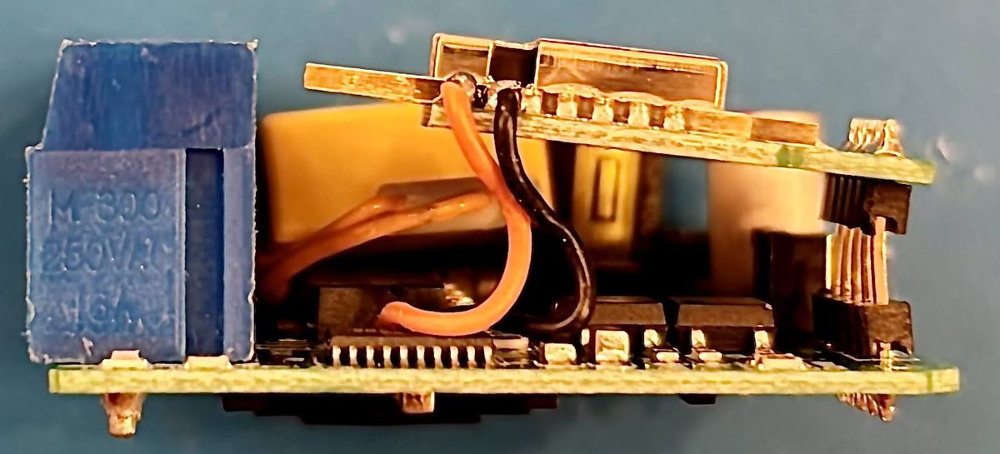

# Open Dimmer

[](https://github.com/patapovich/open-dimmer/actions/workflows/ci.yml)
[](https://github.com/patapovich/open-dimmer/releases/latest)
[](LICENSE)

Open-source firmware for the **AVATTO ZDMS16-2** two-channel Zigbee dimmer. It gives smooth
dimming curves, wall switch gestures and settings per channel. You solder two wires once, and
after that every update comes over Zigbee.



The module has two chips: the **Zigbee module** (ZTU), which talks to Zigbee2MQTT, and the
**dimmer chip** (PY32), which drives the lamps and reads the wall switch. Open Dimmer is the
firmware of the dimmer chip. The Zigbee module runs the ZDMS16-2 build of
[patapovich/tuya-zigbee-switch](https://github.com/patapovich/tuya-zigbee-switch), a fork of
[romasku/tuya-zigbee-switch](https://github.com/romasku/tuya-zigbee-switch). That build installs
Open Dimmer and keeps it up to date.

## Contents

- [Features](#features)
- [Requirements](#requirements)
- [Quick start](#quick-start)
- [Zigbee firmware features](#zigbee-firmware-features)
- [Support](#support)
- [Development](#development)
- [Credits and license](#credits-and-license)

## Features

The stock firmware dims linearly at one fixed rate, shares one power-on setting between the two
channels and reports only on, off and level. Open Dimmer adds, per channel:

- dimming curves for LED and incandescent lamps;
- adjustable fade and hold times, and it follows Zigbee transitions;
- wall switch gestures (single, double, triple press and hold) as Zigbee2MQTT actions, and
  three wall switch modes: normal, detached and off;
- power-on behaviour and level, start boost for LED drivers, auto-off timer, identify;
- health reports;
- safe updates over Zigbee: the light stays as it was, and a failed update reinstalls itself.

### The wall switch: stock vs Open Dimmer

The stock firmware is quirky in use: it reads the wall switch inconsistently and reacts slowly.

| | Stock firmware | Open Dimmer |
|---|---|---|
| Reading the switch | inconsistent | debounced; contact bounce and a switch held at power-up are ignored |
| Brightness changes | one fixed fade (2 s); Zigbee transitions ignored | adjustable fades; Zigbee transitions |
| Tap | on / off | on / off; from dark quickly to the stored level |
| Hold | slow fixed rate (~6 s over the range) | ~3 s over the range (adjustable); from dark it starts at the minimum; slow near the minimum |
| Double, triple press, hold | not reported | Zigbee2MQTT actions; can drive bound lights |
| Modes | the switch always drives the light | normal, detached (only reports), off |
| Stuck input | – | a hold ends by itself |

## Requirements

- **AVATTO ZDMS16-2**, Tuya model `_TZE284_jtbgusdc`. Tested at 230 V / 50 Hz with LED lamps
  and push buttons. The `_TZE204_jtbgusdc` variant and 60 Hz are untested:
  [reports welcome](#support).
- **Zigbee2MQTT**, with the dimmer paired.
- A **soldering iron** and two thin wires, or an [SWD probe](docs/INSTALL-PROBE.md) instead.

## Quick start

1. **Zigbee firmware over the air** from Zigbee2MQTT. The module stays closed.
2. **Solder two wires** inside the module, with the mains disconnected. The Zigbee module stays
   in place.
3. **Close the module and switch it on.** Open Dimmer installs itself in a few seconds.

Full guide with pictures: **[docs/INSTALL.md](docs/INSTALL.md)**.

> [!WARNING]
> **Mains voltage.** The low-voltage side is not isolated from the mains. Open the module only
> with all mains wires disconnected, and close it before you reconnect them.

> [!NOTE]
> Open Dimmer replaces the stock dimmer firmware for good, and the dimmer's settings go back to
> defaults.

## Zigbee firmware features

These work with the stock dimmer chip and with Open Dimmer:

- two dimmable lights with min / max, switch type, power-on behaviour and on level;
- Zigbee Scenes and groups;
- direct control: lights and groups bound to the wall switch follow its on, off and hold, also
  without the coordinator;
- updates over the air, and conversion from the stock Zigbee firmware.

With Open Dimmer, the Zigbee firmware also:

- installs and updates Open Dimmer by itself;
- shows every Open Dimmer setting in Zigbee2MQTT;
- lets wall switch gestures drive bound lights, including double and triple press actions and
  scene recall.

What changed: the [releases](https://github.com/patapovich/open-dimmer/releases) and the
[Zigbee firmware changelog](https://github.com/patapovich/tuya-zigbee-switch/blob/home-dimmer/docs/changelog_home_dimmer.md).
Project state and datapoints: [docs/STATUS.md](docs/STATUS.md).

## Support

- **Bugs and test reports:** [open an issue](https://github.com/patapovich/open-dimmer/issues).
  Add the dimmer's model, `mcu_version` and the Zigbee firmware build (`1.1.3-…`).
- **Chat:** the [tuya-zigbee-switch Discord](https://discord.gg/4HAg2Fr565).

## Development

You need `arm-none-eabi-gcc` and the PY32F0 SDK from
[IOsetting/py32f0-template](https://github.com/IOsetting/py32f0-template). CI pins the commit.

```
make test                                  # host tests
make SDK=<py32f0-template>/Libraries       # build/zdms16_py32.img
```

A `vX.Y.Z` tag publishes a release (`tools/release/release.sh`), and the Zigbee firmware's CI
starts carrying it. Design notes: [docs/BOOTLOADER.md](docs/BOOTLOADER.md).

## Credits and license

- [romasku/tuya-zigbee-switch](https://github.com/romasku/tuya-zigbee-switch): the Zigbee
  firmware this builds on.
- divadiow: the board and pinout pictures (`docs/img/*-elektroda.png`,
  [elektroda.com topic4066696](https://www.elektroda.com/rtvforum/topic4066696.html)). They are
  copied with credit and are not covered by this repository's license.
- [IOsetting/py32f0-template](https://github.com/IOsetting/py32f0-template): the PY32 SDK.

MIT, see [LICENSE](LICENSE). No warranty: you work on a mains device at your own risk. Not
affiliated with AVATTO, Tuya or Puya.
