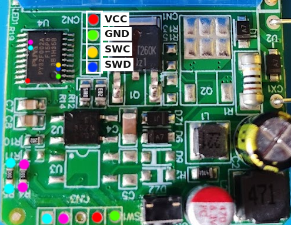

# Installing Open Dimmer with a debug probe

The alternative to the [two-wire install](INSTALL.md), with no soldering: a probe pressed onto
the dimmer's SWD pads installs Open Dimmer in one contact.

1. [Zigbee firmware](#1-zigbee-firmware) over the air, from Zigbee2MQTT.
2. [Set up the PC](#2-set-up-the-pc), once.
3. [Install](#3-install) with the probe.
4. [Close and power on](#4-close-and-power-on).

> [!CAUTION]
> **Never on the mains.** The probe powers the module: all mains wires stay disconnected
> throughout. An install that stopped before **DONE** can leave the dimmer blank: never connect
> such a module to the mains, run the install again instead.

> [!NOTE]
> **Settings go back to defaults:** min 20 %, max 100 %, switch type toggle, power-on off.

## What you need

- **An SWD probe** with a 3.3 V output. Tested: Raspberry Pi Pico with
  [debugprobe](https://github.com/raspberrypi/debugprobe) (`PROBE=cmsis-dap`, the default).
  Untested but known to pyOCD: ST-Link V2 (`PROBE=stlink`), J-Link (`PROBE=jlink`, needs a
  separate 3.3 V supply).
- **A clip or pogo fixture** for the four CN2 pads (pitch most likely 2.0 mm). Wires held by
  hand make the contact unreliable.
- **A Linux PC** with Python 3.

## 1. Zigbee firmware

Do [step 1 of INSTALL.md](INSTALL.md#1-zigbee-firmware-over-the-air) first.

✅ `mcu_firmware` shows "Tuya (stock)".

## 2. Set up the PC

```
sudo apt install python3-venv git curl
mkdir -p ~/open-dimmer && cd ~/open-dimmer
git clone https://github.com/patapovich/open-dimmer fw
git clone https://github.com/IOsetting/py32f0-template
git -C py32f0-template checkout 009bdec7ed77c9b782a258c064c227e15ec19498
python3 -m venv .venv && .venv/bin/pip install pyocd==0.46.1
fw/tools/swd/make_opt_pack.sh "$PWD/py32f0-template" "$PWD/pack"
.venv/bin/pyocd list
```

✅ `pyocd list` shows the probe. If not, add the probe's udev rule.

## 3. Install

1. **Mains off:** disconnect all mains wires, then open the module. Bend the Zigbee module (ZTU)
   carefully aside to reach CN2.
2. **Wire the clip to the probe:**

   | CN2 pad | Signal | PY32 pin | Pico |
   |---|---|---|---|
   | 1 | **SWD** (SWDIO) | 2, PA13 | GP3 |
   | 2 | **SWC** (SWCLK) | 3, PA14 | GP2 |
   | 3 | **GND** | 1 | GND |
   | 4 | **VCC** 3.3 V | 20 | 3V3 OUT |

   

   CN2 is the row of four pads next to the PY32 chip. The row at the board's edge (CN3) is the
   radio header, not for SWD.
3. **Start the install:**

   ```
   cd ~/open-dimmer/fw
   IMAGE=release FREQ=400000 tools/swd/install.sh
   ```

4. **When it beeps,** press the clip onto CN2 and hold it there until it says **DONE**
   (10–20 s).

The script downloads the newest release and checks it against the release's `SHA256SUMS`, then
removes the read protection (which erases the stock firmware), writes the bootloader and Open
Dimmer, reads them back and starts the firmware. On a module that already runs Open Dimmer it
only re-flashes and keeps the settings. `IMAGE=release:vX.Y.Z` picks a release.

> [!IMPORTANT]
> The step after `option bytes: protection off ...` has not run on a stock module yet. If no
> `after reload: OPTR=` line appears within 20 s, lift the clip and press it on again (the
> script waits 60 s); never earlier. If the script stops before **DONE**, run it again.

## 4. Close and power on

1. Take the clip off, close the module, reconnect it and switch the mains on.
2. **Reconfigure** the device in Zigbee2MQTT.
3. Set your settings again. A push button needs switch type **momentary**.

✅ `mcu_firmware` shows "Open Dimmer". If not: switch the module off and on, wait ~30 s and
Reconfigure again.

## By hand

<details>
<summary>The same steps one by one (in <code>~/open-dimmer</code>)</summary>

1. **Read protection off** (erases the stock firmware): run `fw/tools/swd/rdp0_unlock.sh` and
   power-cycle the module's VCC while it tries to attach (90 s), then power-cycle it again.
   "No ACK" means no contact. Alternative: BOOT0 (PY32 pin 5) to 3.3 V before power-up,
   removed before closing.
2. **Brown-out reset** (recommended), then power-cycle (OPTR reads `0x...f9aa`):

   ```
   .venv/bin/pyocd load -t py32f002ax5 --pack pack/Puya.PY32F0xx_DFP.1.1.7-opt.pack -f 400000 \
     -O connect_mode=attach --base-address 0x1FFF0E80 fw/tools/swd/ob_bor25.bin
   ```

3. **Firmware:** `FREQ=400000 IMAGE=release fw/tools/swd/install.sh`, or `IMAGE=<file>` for a
   `zdms16_py32_full.bin` of your own build. It reads back and compares (`make flash-all`
   refuses an image this size).

Never flash a `SIM=1` build to a module that goes back on the mains.

</details>

## Notes

- The bootloader written here installs every later update and stays on the module; it is
  written only over SWD. Health DP 136 reports its checksum; the release notes give the
  expected value.
- After three starts in a row that failed, the bootloader waits 30 s before each start and
  reinstalls the version the Zigbee firmware carries.
- More pictures: [PY32 pinout and CN2](img/dms16-pinout-elektroda.png) (it shows the WiFi model;
  the PY32 side is the same).
- Picture credits: the board and pinout pictures are by divadiow
  ([elektroda.com topic4066696](https://www.elektroda.com/rtvforum/topic4066696.html)), not
  covered by this repository's license.
