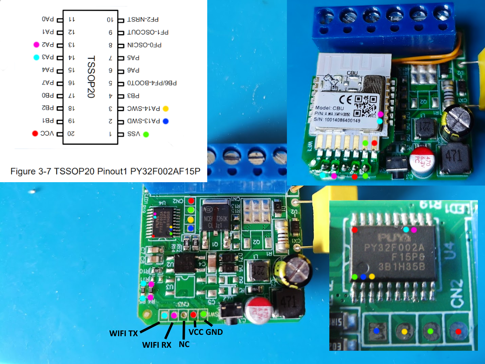
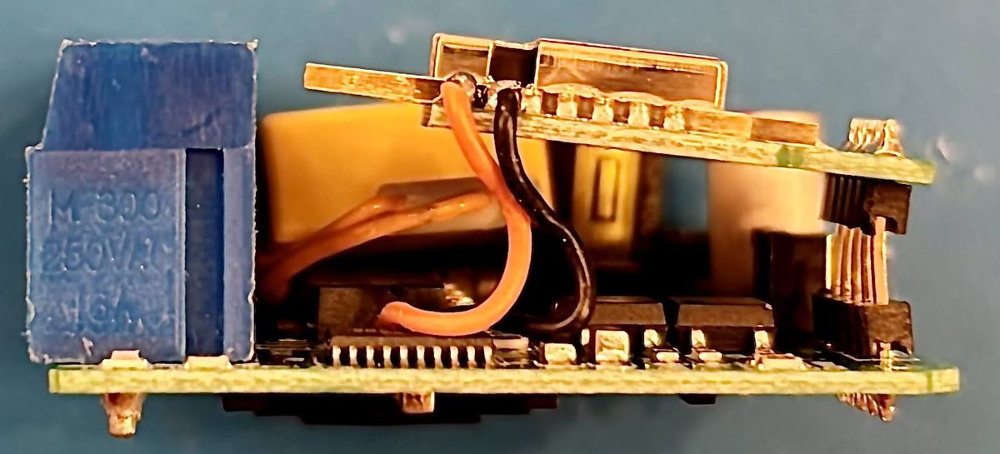
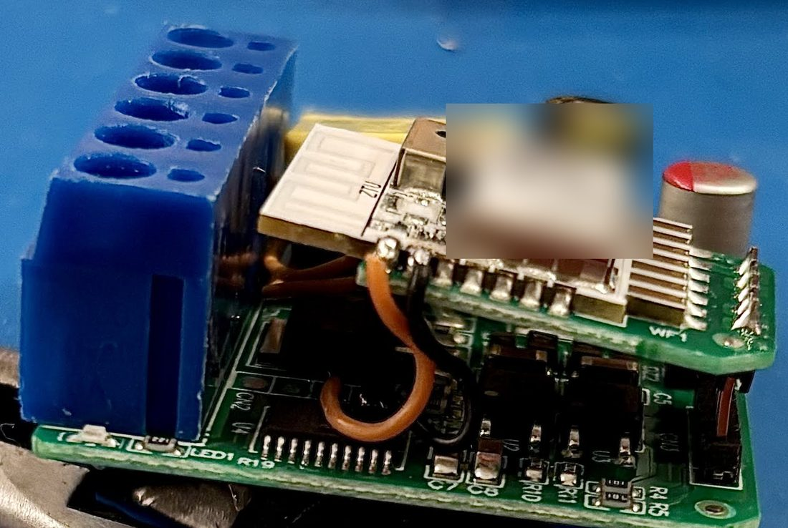
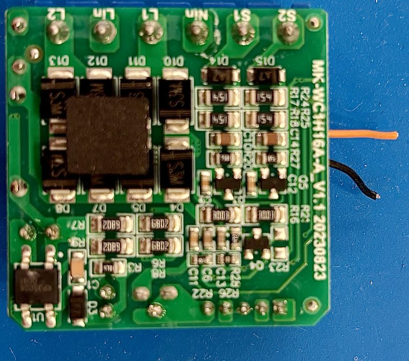

# Installing Open Dimmer on an AVATTO ZDMS16-2

Two steps: the Zigbee firmware over the air, then two soldered wires, and the module installs
Open Dimmer by itself. No debug probe and no computer at the module (the probe path is in the
appendix at the end).

> **Mains voltage.** The module's low-voltage side is not isolated from the mains. Disconnect
> all mains wires before you open it and close it before you reconnect them. Never connect a
> probe, a computer or an earthed oscilloscope to a module on the mains.

> **No way back.** The install erases the stock MCU firmware (read-protected: it cannot be saved
> first) and the settings it keeps (min/max, switch type, power-on). Open Dimmer starts with its
> own defaults and runs only with the fork's Zigbee firmware.

## Quick install: two wires

You need Zigbee2MQTT, a soldering iron with a fine tip and two thin insulated wires a few cm
long (for example 30 AWG wire-wrap wire).

1. Install the fork's Zigbee firmware over the air ([section 0](#0-zigbee-side-first)). Check
   that `mcu_firmware` shows "Tuya (stock)".
2. Write down each channel's `min_level`, `max_level`, `switch_type` and the
   `power_on_behavior` ([why](#before-you-open-it-write-the-settings-down)).
3. Disconnect all mains wires and open the module.
4. Solder ZTU pad **D3** to CN2 pad **SWC** (pad 2) and ZTU pad **D7** to CN2 pad **SWD**
   (pad 1). Nothing else, no solder bridges ([section A](#a-two-wires-no-probe) has the
   pictures).
5. Close the module, reconnect it and switch the mains on. The lamps stay dark for a few seconds
   while it installs.
6. Within about 10 s Zigbee2MQTT shows `mcu_firmware` "Open Dimmer" and `mcu_version` 2.x.y.
   Press **Reconfigure** on the device, then set min / max, switch type and power-on again
   ([section 2](#2-back-in-service), steps 4–5).

If it does not work:

- `mcu_firmware` says "power-cycle the module to install Open Dimmer": the wires were there
  before the Zigbee firmware. Switch the module off for a few seconds and on again.
- Still "Tuya (stock)" after a power cycle: set the device option `mcu_flasher` to `show` and
  read `mcu_flasher_status` ([watching it](#a-two-wires-no-probe)). With
  `no answer (wires? power?)` check the two joints, mains off.
- A `device_config` written by hand gets `SWD3D7;` once with the Zigbee firmware update; if you
  removed it later, add it back ([section A](#a-two-wires-no-probe)).
- A power cut during the install: switch on again, it carries on or starts over by itself.

The sections below are the details.

## 0. Zigbee side first

The module must run the Zigbee firmware that carries Open Dimmer: the ZDMS16-2 build of
the fork [patapovich/tuya-zigbee-switch](https://github.com/patapovich/tuya-zigbee-switch)
(branch `home-dimmer`, built on `home-dimmer_build`), based on
[romasku/tuya-zigbee-switch](https://github.com/romasku/tuya-zigbee-switch). It is installed
over the air from the stock firmware, no opening needed:

1. Follow the upstream guide for Zigbee2MQTT:
   [conversion from the stock firmware](https://github.com/romasku/tuya-zigbee-switch/blob/main/docs/updating.md#conversion)
   and [external converters](https://github.com/romasku/tuya-zigbee-switch/blob/main/docs/updating.md#quirks--converters--extensions),
   but take the fork's files (only the fork has the ZDMS16-2 with Open Dimmer):
   - OTA index (`ota.zigbee_ota_override_index_location`):
     `https://raw.githubusercontent.com/patapovich/tuya-zigbee-switch/home-dimmer_build/zigbee2mqtt/ota/index_router.json`.
     It lists only the ZDMS16-2 (the update and the conversion from stock), and Zigbee2MQTT takes
     only one override index. If other devices of yours run tuya-zigbee-switch firmware, this
     index alone stops their updates and conversions. Merge upstream's index and the fork's into a
     local file instead: run the commands below in the Zigbee2MQTT data directory (next to
     `configuration.yaml`), set the option to `ota_index.json`, and run them again to pick up new
     releases. Upstream entries for the fork's devices are dropped, all others are kept. They need
     `curl` and `jq` 1.6 or newer, in any POSIX shell. If you use another upstream index
     (`index_end_device.json` or a `-FORCE` one), put its name in the first URL; the fork's
     ZDMS16-2 entries are in its `index_router.json`.

     ```
     curl -fsSL -o ota_upstream.json https://raw.githubusercontent.com/romasku/tuya-zigbee-switch/refs/heads/main/zigbee2mqtt/ota/index_router.json &&
     curl -fsSL -o ota_fork.json https://raw.githubusercontent.com/patapovich/tuya-zigbee-switch/refs/heads/home-dimmer_build/zigbee2mqtt/ota/index_router.json &&
     jq -s '(.[1] | map(.manufacturerName[]?)) as $m
            | [.[0][] | select(any(.manufacturerName[]?; IN($m[])) | not)] + .[1]' \
       ota_upstream.json ota_fork.json > ota_index.json.new &&
     mv ota_index.json.new ota_index.json
     ```

     Zigbee2MQTT reads this file at every OTA check of every device, and an empty or broken file
     makes all of those checks fail. So the last line replaces it only when both downloads and jq
     have succeeded; otherwise the old file stays.

   - the converter `switch_custom.js` (it also gives the stock module OTA: `tuya_with_ota.js` is
     not needed):
     [zigbee2mqtt/converters](https://github.com/patapovich/tuya-zigbee-switch/tree/home-dimmer_build/zigbee2mqtt/converters)
   - images, if you install them by hand:
     [bin/router/MODULE_AVATTO_ZDMS16_2](https://github.com/patapovich/tuya-zigbee-switch/tree/home-dimmer_build/bin/router/MODULE_AVATTO_ZDMS16_2)
     (`*-from_tuya.zigbee` converts a stock module, the plain `.zigbee` updates a converted one)
2. Wait after the conversion and leave the power on. The new firmware can take several minutes
   (about 6 seen) to come back on the network after the transfer. Zigbee2MQTT stops waiting
   after 2 minutes, reports the update as done, and shows the stock values from its database
   until then. The module's LED stays dark. The conversion is through when Zigbee2MQTT shows
   the model id `TS0601-ZDMS16-2` and the software build `1.1.3-…` for it.
3. Interview the device in Zigbee2MQTT (Devices → the device → Interview), then reconfigure
   it. The interview is needed first: the database still holds the stock firmware's endpoints
   (1 and 242), and a reconfigure without it fails with "Cannot read properties of undefined
   (reading 'bind')". Without the reconfigure the reporting binds are missing, and wall
   switch changes never reach Zigbee2MQTT.
4. Check that it works with the
   stock MCU: `mcu_version` shows the stock version (for example 1.0.7) and `mcu_firmware` shows
   "Tuya (stock)". Only then open the module for the MCU part below. An older converter of the
   fork has no `mcu_firmware`: there `mcu_version` alone is the check, Open Dimmer shows later
   as `mcu_version` "2.x.y own", and the device option is called `own_mcu_settings`.

> **Open Dimmer under the stock Zigbee firmware.** Open Dimmer under the stock Zigbee firmware is not supported, but safe:
> the light works from the wall switch and the module button, Zigbee control may not work, the
> MCU gets no updates, and every power-up takes ~3 s before the light reacts. If it happens (an
> MCU installed with a probe before section 0, or the Zigbee firmware put back to stock), do not
> re-pair or reset the module (that can lose the name the conversion needs): convert the Zigbee
> firmware over the air first (section 0). Then everything below applies.

## Before you open it: write the settings down

Removing the read protection also erases the settings the stock MCU keeps. The MCU then starts
with Open Dimmer's defaults: min 20 % (MCU 200, `min_level` 51), max 100 % (1000, 254),
switch type toggle, power-on off, dimming curve led_soft. These can drive an existing setup
wrongly: with toggle a push button lights the lamp only while it is held, and the brightness of
every level changes.

Before the erase, write down for each channel, from Zigbee2MQTT (or Home Assistant):

- `min_level` and `max_level` (on the 1..254 scale; values set from Zigbee2MQTT come back
  exactly when written again),
- `switch_type`,
- `power_on_behavior` (the stock MCU has one setting for both channels).

The exact MCU values are the raw DPs: 3 min, 5 max, 4 switch type for channel 1; 9, 11, 10 for
channel 2; 14 power-on. One place to read them is the fork's log of the MCU link: Basic
attributes 0xff41..0xff45 on endpoint 1 hold its last 30 events of every kind (sent and received
DPs and commands, acks, timeouts), so the dump from the first contact has scrolled out soon.
Fill it on demand: write 1 to Basic attribute 0xff4f (clears the log), then 2 (asks the MCU for
all its DPs), and read 0xff41..0xff45 right after. Each 8-byte entry is the time in ms (2 bytes),
the kind (3 or 4 = a DP report), the DP id and the value (4 bytes), little-endian. The fork's
`helper_scripts/decode_mcu_diag.py` decodes them.

## A. Two wires, no probe

The fork's Zigbee firmware has an SWD master: over two wires from the Zigbee module (the ZTU) to
the MCU's SWD pads it removes the read protection, writes the bootloader, and the bootloader then
fetches Open Dimmer from the Zigbee firmware over the serial link, as for every update. It does
this by itself at the first power-up that sees the wires. Nothing to run on a computer, no
Zigbee2MQTT command.

You need a soldering iron with a fine tip and two thin insulated wires, a few cm each (for
example 30 AWG wire-wrap wire). Plain wires, nothing else in between.

1. Section 0 first, and check there that the module works with the stock MCU
   (`mcu_firmware` "Tuya (stock)").
2. Disconnect all mains wires and open the module.
3. Solder the two wires:

   | ZTU pad | to CN2 pad | Signal |
   |---|---|---|
   | D3 | SWC (pad 2) | SWCLK, PY32 PA14 |
   | D7 | SWD (pad 1) | SWDIO, PY32 PA13 |

   D3 and D7 are the two pads above C0 on the ZTU's edge that has C0, SWS, B6, A0 and A1: on
   the module they are the first two pads of that edge at the end away from the ZTU's pin
   header (its antenna end). On the stock board nothing is connected to them. GND and 3.3 V
   need no wire: the two parts already share them. Check that no solder bridges D3, D7 and C0,
   and that the wires touch nothing else.

   

   (Drawing: the fork's [ZTU front view](https://github.com/patapovich/tuya-zigbee-switch/blob/home-dimmer/docs/diagrams/telink/ZTU_front.png),
   MIT license, with D3 and D7 marked.)

   CN2 is the row of four pads next to the PY32 (close-up at the bottom right of the picture
   below; the pads in detail under "What you need for a probe"): SWD is pad 1 (blue), SWC
   pad 2 (yellow).

   

   (Picture by divadiow, elektroda.com thread
   [topic4066696](https://www.elektroda.com/rtvforum/topic4066696.html); not covered by this
   repository's MIT license. It shows the WiFi model; the PY32 side is the same.)

   The two wires on a module (the ZTU on top, its pin header at the right; the wires run from
   its D3 / D7 down to CN2 next to the PY32):

   

   

   The board these photos show, from below (MK-WC1H16A-A V1.1, 2023-08-23):

   
4. Close the module, reconnect it and switch the mains on.

At this power-up the Zigbee firmware sees the wires, catches the MCU before the stock firmware
starts, and installs Open Dimmer. The lamps stay dark meanwhile. Within about 10 s Open Dimmer
runs, and Zigbee2MQTT shows `mcu_firmware` "Open Dimmer" and `mcu_version` (`2.x.y`) by itself.
Then press **Reconfigure** on the device: only then does Zigbee2MQTT show the settings that only
Open Dimmer has (per channel the dimming curve, the power-on behaviour, fade and hold, and the
wall switch gestures as `action`), and Home Assistant gets entities for them. The shared
`power_on_behavior` is replaced by the per-channel ones: update automations that use it. Open
Dimmer starts with its defaults: min 20 %, max 100 %, switch type toggle, power-on off, dimming
curve led_soft. Set them as in steps 4–5 of section 2 below.

- **Once per module.** The firmware does this by itself only once in the module's life: at the
  first power-up that sees the wires. Later installs are started by hand (below).
- **Power cut during the install.** Switch the power on again: from the step that erases the
  stock firmware on, the install goes on at every power-up until it has finished. Before that
  step the stock firmware is still there, and the next power-up starts over.
- **Wires soldered before section 0** (the module still ran the stock Zigbee firmware). The
  conversion restarts only the Zigbee module; the stock MCU runs on and holds its SWD pins, so
  the install waits for a power cycle: `mcu_firmware` shows "Tuya (stock): power-cycle the
  module to install Open Dimmer" (after the Reconfigure of section 0). Power the module off for
  a few seconds and on again: that power-up installs Open Dimmer.
- **A `device_config` written by hand.** The board's default config names the two pins (the
  token `SWD3D7;`). A config written before the default had it gets the token once with the
  Zigbee firmware update (home-dimmer 2b098b13, 2026-11-20, or later); one removed by hand
  afterwards stays removed. Then append `SWD3D7;` again (the module restarts) and power-cycle the
  module once.
- **Already Open Dimmer** (installed with a probe): the firmware sees that the MCU is not
  read-protected and leaves it alone.

**Watching it, starting it by hand.** While the MCU is not Open Dimmer yet, `mcu_firmware` also
tells an install that waits for a power cycle, runs ("installing Open Dimmer") or failed. For
the details set the device option `mcu_flasher` to `show`
(Zigbee2MQTT: the device → Settings (specific)). `mcu_flasher_status` then shows the last job,
for example `done install; ...`, `armed install; power-cycle the module now (...)` while it
waits for a power-up, or `failed install; error: ...` with the reason. After a failure (for example
`no answer (wires? power?)` or `no attach in the armed power-ups`: check the two wires, with
the mains off), start it again by hand: write `install` to `mcu_flasher_confirm`, then within
60 s set `mcu_flasher` to `install`, and power-cycle the module when the status says so.
`install` is taken only while the MCU runs its stock firmware.

## Updates

The Zigbee firmware carries Open Dimmer and updates the MCU when it runs an older version of
Open Dimmer (never the stock firmware). Update the Zigbee firmware over the air as usual;
the MCU follows a few seconds after the module restarts, and the light comes back as it was.
From 2.1.13 on every image has a build number (2.1.13 is build 300), and a Zigbee firmware that
knows build numbers offers by build; older ones offer by version.

## Appendix: with a debug probe

The original path: the probe removes the read protection and flashes Open Dimmer, the module
off the mains. Needed only without the two wires.

## What you need for a probe

> **Blank until DONE.** Once the probe has removed the read protection, the PY32 is blank or
> incomplete until the install has finished: nothing drives the dimmer outputs. Do NOT connect
> such a module to the mains. If anything fails or stops half way, rerun the install (`tools/swd/install.sh`, or
> the steps by hand) until it has written and checked the firmware.

- A debug probe with SWD and a 3.3 V output to power the module. Tested: a Raspberry Pi Pico /
  RP2040 board with the [debugprobe](https://github.com/raspberrypi/debugprobe) firmware.
  Should work too (pyOCD and OpenOCD know them; not tried here):

  | Probe | `PROBE=` | Powers the module |
  |---|---|---|
  | Pico / RP2040 with debugprobe (CMSIS-DAP) | `cmsis-dap` (default) | yes, 3V3 OUT |
  | ST-Link V2 (also the cheap clones) | `stlink` | yes, 3.3V pin |
  | SEGGER J-Link | `jlink` | not by default: use a separate 3.3 V supply |
  | other CMSIS-DAP probes (DAPLink, ...) | `cmsis-dap` | depends on the probe |

- A way to hold four contacts on the module's **CN2** pads (SWD, SWC, GND, VCC; not CN3,
  which is the radio header) without your hands.

  Where they are (picture by divadiow, first post of the elektroda.com thread
  [topic4066696](https://www.elektroda.com/rtvforum/topic4066696.html), 23 Jul 2024; copied here
  with credit, not covered by this repository's MIT license):

  

  The picture shows the WiFi model (DMS16-W1, board MK-WC1H16A-A with a CBU module), but the
  PY32 side and its pinout are the same on the ZDMS16-2. The close-up at the bottom right shows
  CN2 with its pads colour-coded to the PY32 pins. On the ZDMS16-2 the Zigbee module does not have
  to be desoldered: bend it carefully aside to reach CN2.

  | CN2 pad (left to right in the close-up) | Colour there | Signal | PY32F002A pin (TSSOP20) |
  |---|---|---|---|
  | 1 | blue | SWD (SWDIO) | 2, PA13 |
  | 2 | yellow | SWC (SWCLK) | 3, PA14 |
  | 3 | green | GND | 1, VSS |
  | 4 | red | VCC 3.3 V | 20, VCC |

  CN3 (five pins at the board edge) is the radio module's header (TX, RX, NC, VCC, GND): do not
  use it for SWD.

  The CN2 pads are closer than 2.54 mm, most likely **2.0 mm** pitch (to be confirmed: first to
  last pad centre ≈ 6.0 mm at 2.0 mm, ≈ 3.8 mm at 1.27 mm). Options:
  - a single-row **4-pin pogo-pin clip / PCB clamp fixture in 2.0 mm pitch** (search "PCB clamp
    fixture 2.0mm 4P pogo pin"; the common 2.54 mm ones do not fit), if the pads are close
    enough to the board edge for its jaws;
  - otherwise a 2.0 mm 4-pin **spring-loaded (pogo) connector** pressed down with a small clamp or
    a printed jig.
  Holding wires by hand works but makes the attach unreliable.
- Linux with OpenOCD (0.12 used) and Python 3, plus the tools the scripts call:

  ```
  sudo apt install openocd python3-venv git zip unzip curl
  sudo apt install make gcc-arm-none-eabi libnewlib-arm-none-eabi   # only to build it yourself
  ```

  A work directory holds the clone (it must be called `fw`), the Python environment `.venv` and
  the option-byte pack `pack/`; the SDK sits beside it. The SDK commit is the one CI builds
  with, and pyOCD is the version every step here was run with:

  ```
  mkdir -p ~/projects/zdms16-py32 && cd ~/projects/zdms16-py32       # the work directory
  git clone https://github.com/patapovich/zdms16-py32 fw
  git clone https://github.com/IOsetting/py32f0-template ../py32f0-template
  git -C ../py32f0-template checkout 009bdec7ed77c9b782a258c064c227e15ec19498
  python3 -m venv .venv && .venv/bin/pip install pyocd==0.46.1
  fw/tools/swd/make_opt_pack.sh "$PWD/../py32f0-template" "$PWD/pack"
  .venv/bin/pyocd list                                               # the probe must show up
  ```

  `tools/swd/install.sh` and `rdp0_unlock.sh` find `.venv` and `pack/` next to `fw` wherever the
  work directory is. The Makefile defaults to the paths above (`~/projects/zdms16-py32` and
  `~/projects/py32f0-template`); elsewhere give them to `make`:

  ```
  make SDK=<template>/Libraries PYOCD=<work>/.venv/bin/pyocd \
       PACK=<work>/pack/Puya.PY32F0xx_DFP.1.1.7-opt.pack ...
  ```

  If `pyocd list` shows no probe or a permission error, the probe needs a udev rule (the
  openocd package brings rules for the common ones). The commands below run in the work
  directory or in `fw`.

## 1. Probe install: one contact

| Pico (debugprobe) | Module CN2 |
|---|---|
| GND | GND |
| 3V3 OUT | VCC |
| GP2 | SWC (PA14) |
| GP3 | SWD (PA13) |

With the module off the mains and the clip wired to the probe:

```
cd fw
IMAGE=release FREQ=400000 tools/swd/install.sh     # or build first and leave IMAGE out
```

When it beeps and says so, press the clip onto CN2 and hold it until **DONE** (about
10–20 s). In that one contact the script:

1. attaches right at power-up (the stock firmware takes the SWD pins a moment later),
2. asks once, then writes the option bytes in one go: read protection off (this **erases
   the stock firmware**) and brown-out reset at 2.5 V,
3. reloads the option bytes without a power cycle (FLASH_CR OBL_LAUNCH). If the chip does not
   come back, the clip must be lifted and pressed on again (the script waits 60 s for it; when
   to do it: see the note below),
4. writes bootloader + app, reads it back and compares, and starts the firmware.

On a module that already runs Open Dimmer it skips steps 2–3 and just re-flashes. A SIM
(bench) build is refused. Other probes: `PROBE=stlink` or `PROBE=jlink`. `FREQ` is pyOCD's SWD
clock: the script's default of 4 MHz has never been tested, every tested step ran at 400 kHz,
so give `FREQ=400000` as above.

The bootloader written here stays on the module for good (docs/BOOTLOADER.md). Before it
attaches, the script shows the image's bootloader version and its boot sector CRC (the value the
module later reports as DP 136; note it per module) and refuses:
- a full image whose bootloader has no identity (`boot_id`, the v1 bootloader of 2.1.x);
- an image over 12 KB reaches sector 4, which pyOCD erases whole: `install.sh` reads the sector
  first and writes it back with the image merged in, so the settings (switch type, curves,
  levels) stay; `ERASE_SETTINGS=1` erases them instead.

`IMAGE=release` (the newest release) or `IMAGE=release:vX.Y.Z` downloads the full image with the
release's `boot.bin`, app image and `SHA256SUMS`, checks all three against the list and checks
that the full image is exactly that bootloader and app. `WRP=1` write-protects the bootloader's
sector after the write (off by default; try it on a spare first); a later install clears the
protection by itself before it writes. Before every reset it issues, the script (like
`make flash-all`) clears the bootloader's boot word in RAM, so the new firmware starts with a
fresh try counter. On a stock module it does so only from the firmware write on: the stock
firmware has no boot word, removing the read protection erases it anyway, and between the attach
and the option reload the script starts no tool it does not need, so that the stock firmware
gets no time to take the SWD pins.

> The one-contact path with the option reload has not been run on a stock module yet (the
> first module here was unlocked with the separate steps below). If anything is off, the
> script stops with a message; the steps by hand below always work. If no `after reload:
> OPTR=` line has appeared 20 s after the `option bytes: protection off ...` line and the script
> has not asked yet, lift the clip and press it on again (the script waits 60 s for it). Never
> lift it earlier: in the first seconds after that line the option bytes are being written.
> After the second press the script checks read protection, BOR and write protection as after
> the first.
> If it stopped before **DONE**, the PY32 may be blank: do NOT connect the module to the
> mains, run the install again.

## 2. Back in service

Only after the install said **DONE** (or every step by hand succeeded, with the firmware
written last): a blank or half-installed PY32 must never go on the mains. Rerun the install
instead.

Keep the wall switch and any automations away from the module until step 4 is done (disable
automations that drive it).

1. Power-cycle, disconnect the probe, close the module, connect it to the mains.
2. In Zigbee2MQTT, press **Reconfigure** on the device: it reads the MCU version and the
   settings again. Check that `mcu_firmware` shows "Open Dimmer" and `mcu_version` the installed
   version (`2.x.y`). If it does not (for example "Tuya (stock)"), Reconfigure alone does not
   help: the Zigbee firmware asks the MCU who it is once, after its own start. Power-cycle the
   module (mains off for a few seconds, then on), wait about 30 s and Reconfigure again. If it
   still does not show "Open Dimmer", check that the module runs the fork's current Zigbee
   firmware and Zigbee2MQTT the fork's current converter (section 0). Do not restart
   Zigbee2MQTT before it shows "Open Dimmer". An older fork converter has no `mcu_firmware`:
   there `mcu_version` "2.x.y own" means the same.
3. Then restart Zigbee2MQTT once. Only then does it show the settings that only Open Dimmer has
   (device option `open_dimmer_settings`, `own_mcu_settings` in an older converter: auto, the
   default, shows them once the module has identified the MCU as Open Dimmer; show / hide:
   always / never), and Home Assistant gets entities for them: per channel the dimming curve,
   the power-on behaviour, fade and hold, and the wall switch gestures as `action`. The shared `power_on_behavior` is replaced by the
   per-channel `power_on_behavior` entities: update automations that use it.
4. Restore the settings you wrote down, per channel:
   - `dimming_curve` to `linear` first: it gives every level the same conduction as the stock
     firmware, so the old min/max, `on_level` and the brightness values in automations keep
     their meaning. Every other curve (led_soft is the default) changes how bright each level
     is: switch later on purpose and retune min/max, `on_level` and automations then;
   - `min_level` and `max_level`. min = max is accepted: every level then gives that one
     conduction (`min_level` = `max_level` = 254: full conduction, no phase cut);
   - `switch_type` (momentary for push buttons);
   - `power_on_behavior` (the old shared value on both channels).

   Check that Zigbee2MQTT shows the values back.
5. A new lamp, with nothing to restore: `min_level` just above the level where the lamp still
   lights from dark, then `dimming_curve` (led_soft is the default and suits most LED lamps;
   led, led_deep or led_deeper if the dim end passes too quickly), and the switch type of the
   wall switch (momentary for push buttons).

## By hand (the same steps one by one)

### Wiring

| Pico (debugprobe) | Module CN2 |
|---|---|
| GND | GND |
| 3V3 OUT | VCC |
| GP2 | SWC (PA14) |
| GP3 | SWD (PA13) |

Put the 3V3 wire on a contact you can open and close easily: the next step needs a power
cycle while the script runs.

### Remove the read protection (erases the stock firmware)

```
fw/tools/swd/rdp0_unlock.sh          # in the work directory
```

The script keeps trying to attach for 90 s. **Power-cycle the module's VCC while it runs.** The
stock firmware takes the SWD pins over shortly after power-up, so the attach has to happen in
that window. Once the core is halted, the script writes option bytes with RDP = 0xAA
(`tools/swd/ob_rdp0.bin`: `aa f0 55 0f ff 00 00 ff ...`). The chip then erases its flash.
Power-cycle the module again afterwards. From here until the firmware is flashed (last step),
the PY32 is blank: do NOT connect the module to the mains. If a step fails, repeat it.

If the attach never succeeds, check the wiring first ("No ACK" means no contact). As an
alternative, tie BOOT0 (PY32 pin 5) to 3.3 V before power-up: the ROM bootloader then runs
instead of the stock firmware (see `tools/swd/dump_py32.sh`). That takes a thin wire soldered to
pin 5 of the TSSOP20. Remove it before the module is closed: while BOOT0 is high, the MCU starts
its ROM bootloader at every power-up instead of the firmware.

### Brown-out reset (recommended)

BOR at 2.5 V makes the MCU reset cleanly when the supply sags, instead of running on undefined:

```
.venv/bin/pyocd load -t py32f002ax5 --pack pack/Puya.PY32F0xx_DFP.1.1.7-opt.pack -f 400000 \
    -O connect_mode=attach --base-address 0x1FFF0E80 fw/tools/swd/ob_bor25.bin
```

`ob_bor25.bin` is `aa f9 55 06 ff 00 00 ff ...` (RDP stays 0xAA, BOR on at 2.5 V). Power-cycle
the module afterwards. `read32 0x40022020` in `pyocd commander` shows OPTR `0x...f9aa`.

### Flash the firmware

```
cd fw
make flash-all                      # builds and writes bootloader + app (full image)
```

or, with a release file, in the work directory: download it with the release's `SHA256SUMS` and
check it (it must say `zdms16_py32_full.bin: OK`; the `sed` drops the `build/` paths that the
lists of releases up to v2.1.11 have). Then the first `pyocd` command stops the firmware's
watchdog while the core is halted (as `make flash-all` and `install.sh` do), which a re-flash of
a running module needs:

```
curl -fsSLO https://github.com/patapovich/zdms16-py32/releases/latest/download/zdms16_py32_full.bin
curl -fsSLO https://github.com/patapovich/zdms16-py32/releases/latest/download/SHA256SUMS
sed 's|  .*/|  |' SHA256SUMS | sha256sum -c --ignore-missing
.venv/bin/pyocd commander -t py32f002ax5 --pack pack/Puya.PY32F0xx_DFP.1.1.7-opt.pack -f 400000 \
    -O connect_mode=attach -O resume_on_disconnect=false -c "write32 0x40015808 0x1000" \
    -c "write32 0x20000BF8 0" -c "write32 0x20000BFC 0"
.venv/bin/pyocd load -t py32f002ax5 --pack pack/Puya.PY32F0xx_DFP.1.1.7-opt.pack -f 400000 \
    --format bin --base-address 0x08000000 zdms16_py32_full.bin
```

The two `write32 0x20000BF8 / 0x20000BFC` clear the v2 bootloader's boot word in RAM: a debugger
reset keeps the RAM, and the new firmware should start with a fresh try counter (as `make
flash-all` and `install.sh` do).

`FREQ=400000 IMAGE=<file> fw/tools/swd/install.sh` does the same and also reads the flash back
and compares.

Never flash a `SIM=1` build to a module that will go back on the mains: it simulates the
zero cross and does not follow the real one.

## Bootloader v2 (from 2.1.13)

The bootloader is the small part of the firmware in the PY32's first 4 KB that installs the
updates. It is written only over SWD, with the full image, and then stays on the module for
good. A full image from 2.1.13 on has bootloader **v2**; modules installed with 2.1.12 or older
have v1.

- **v1 to v2.** A module on v1 takes every app update over Zigbee as before (2.1.13 included),
  but none of the v2 escape paths below. To get v2, re-flash the module once over SWD with the
  release's full image, off the mains as in section 1: `FREQ=400000 IMAGE=release
  tools/swd/install.sh`. On a module that already runs Open Dimmer this only re-flashes; the
  settings in the last 4 KB sector stay, also with an image over 12 KB (`install.sh` reads the
  sector first and writes it back with the image merged in; `ERASE_SETTINGS=1` erases them
  instead); `make flash-all` refuses an image over 12 KB.
- **Check.** DP 136 in the health report (logged by the Zigbee firmware's MCU link log) is the
  CRC-32 of the bootloader sector: the value the release notes give for the release's
  bootloader (the released v1: 0xEAC45031). The Zigbee firmware's link log also shows the
  bootloader version (2) in the MCU's update requests.

What v2 does by itself:

- **At power-on** it asks the Zigbee firmware for the image it carries and installs it if its
  build is newer than the installed one, even if the installed app cannot take updates. The light
  comes when the Zigbee firmware answers (within ~1.5 s after the power came, by the Zigbee
  firmware's own rule), or after 3 s without an answer.
- **After 3 starts in a row that never confirmed themselves** (an app that crashes or hangs, or
  cannot talk to the Zigbee firmware for its first 30 s) it listens for 30 s before each further
  start and installs any other image the Zigbee firmware carries, older ones too. The light then
  takes the power-on setting.
- **Link watchdog** (from 2.1.13, needs v2): if the app hears nothing from the Zigbee firmware
  for 30 min, it restarts (at most every ~4 h, and only once every channel has been off and no
  switch or button used for a minute) and the bootloader checks for a newer build. The light
  state stays; the wall switch is not read for up to ~3 s, longer while a newer build is being
  installed (~2.5 s more; a transfer that stalls ends 10 s later with the old app unharmed).

### Button rescue (v2)

The module button can force such a 30 s window, for example to go back to an older image that
the Zigbee firmware carries. The module stays in its insulated case on the mains: press the
button through the case, never open the case while the mains is connected (see "Mains voltage"
above).

1. Switch the power to the module off.
2. Press the module button through the case and keep it pressed.
3. Switch the power on. When the LED lights, let go within 5 s.
4. The LED blinks slowly while the module waits for an image and fast while it writes one. If
   the Zigbee firmware carries an image other than the installed one, it is installed and the
   light starts with the power-on setting. With the same image the light starts after ~30 s.

Held for more than 5 s, the button counts as stuck: the module starts normally after ~5 s and
installs nothing. A press held on into the running app does not start a rejoin: the app does
not take a module-button hold that began in its first 10 s after a power-up as one.
