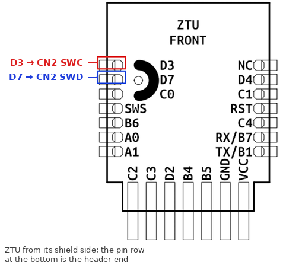
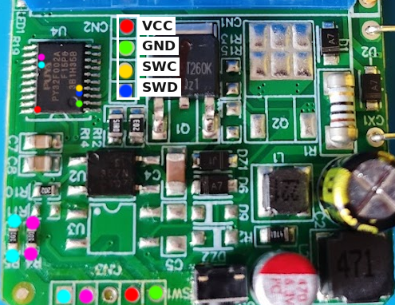
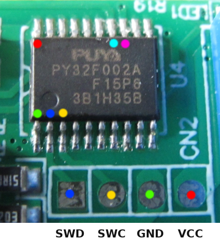

# Installing Open Dimmer on an AVATTO ZDMS16-2

1. [Zigbee firmware over the air](#1-zigbee-firmware-over-the-air), from Zigbee2MQTT.
2. [Two wires](#2-solder-two-wires) soldered inside the module.
3. [Close and power on](#3-close-and-power-on): Open Dimmer installs itself.

You need Zigbee2MQTT, a fine-tipped soldering iron and two thin insulated wires a few cm long
(e.g. 30 AWG wire-wrap). With a debug probe instead of the wires: [INSTALL-PROBE.md](INSTALL-PROBE.md).

> [!WARNING]
> **Mains voltage.** The low-voltage side is not isolated from the mains. Disconnect all mains
> wires before you open the module, and close it before you reconnect them.

> [!NOTE]
> **Settings go back to defaults:** min 20 %, max 100 %, switch type toggle, power-on off.
> Set them again in Zigbee2MQTT after the install.

## 1. Zigbee firmware over the air

The module stays closed and keeps working with its stock MCU firmware.

1. **OTA index.** Zigbee2MQTT → Settings → OTA updates → OTA index override file name:

   ```
   https://raw.githubusercontent.com/patapovich/tuya-zigbee-switch/home-dimmer_build/zigbee2mqtt/ota/index_router.json
   ```

   It lists only the ZDMS16-2. Other tuya-zigbee-switch devices in the same network:
   [merge the indexes](#other-tuya-zigbee-switch-devices).
2. **Converter.** Download `switch_custom.js` from
   [zigbee2mqtt/converters](https://github.com/patapovich/tuya-zigbee-switch/tree/home-dimmer_build/zigbee2mqtt/converters)
   into the `external_converters/` folder of the Zigbee2MQTT data directory (next to
   `configuration.yaml`; create the folder if needed).
3. **Restart** Zigbee2MQTT.
4. **Update.** OTA page → check for updates on the dimmer → update.
5. **Wait.** The module can be away up to ~6 minutes with its LED dark; leave the power on. If
   it is still missing after that, Permit join.
6. When Zigbee2MQTT shows the model `TS0601-ZDMS16-2` and the build `1.1.3-…`: **Interview**,
   then **Reconfigure** the device.

✅ `mcu_firmware` shows "Tuya (stock)".

More detail: the upstream [conversion guide](https://github.com/romasku/tuya-zigbee-switch/blob/main/docs/updating.md#conversion).

## 2. Solder two wires

1. **Mains off:** disconnect all mains wires, then open the module.
2. **Find D3 and D7** on the Zigbee module (ZTU): the first two pads at the antenna end of the
   edge with C0, SWS, B6, A0 and A1. Nothing else is connected to them.

   

3. **Find CN2:** the row of four pads next to the PY32 chip.

   | The board | CN2 |
   |---|---|
   |  |  |

4. **Solder:**

   | ZTU pad | → | CN2 pad |
   |---|---|---|
   | **D3** | → | **SWC** (pad 2) |
   | **D7** | → | **SWD** (pad 1) |

   

5. **Check:** no solder bridges, and the wires touch nothing else.

## 3. Close and power on

1. Close the module, reconnect it and switch the mains on.
2. Wait about 10 s. The lamps stay dark while Open Dimmer installs.
3. **Reconfigure** the device in Zigbee2MQTT.
4. Set your settings again. A push button needs switch type **momentary**.

✅ `mcu_firmware` shows "Open Dimmer", `mcu_version` 2.x.y, and the Open Dimmer settings appear
per channel: dimming curve, power-on behaviour, fade and hold times, wall switch gestures as
`action`.

`power_on_behavior` is now one per channel: update automations that use the shared one.

## If it does not work

| Problem | Do |
|---|---|
| `mcu_firmware` "power-cycle the module to install Open Dimmer" | The wires were there before step 1. Switch the module off for a few seconds and on again. |
| `mcu_firmware` still "Tuya (stock)" | Set the device option `mcu_flasher` to `show` and read `mcu_flasher_status`. |
| `mcu_flasher_status` "no answer (wires? power?)" | Mains off, check the two joints. |
| Start the install again | Write `install` to `mcu_flasher_confirm`, within 60 s set `mcu_flasher` to `install`, power-cycle the module when the status asks for it. |
| Power cut during the install | Switch on again: it goes on or starts over by itself. |

The automatic install runs once per module, at the first power-up that sees the wires; a
module that already runs Open Dimmer is left alone. A `device_config` written by hand gets
`SWD3D7;` once with the update: if you remove it later, add it back.

## Updates

Update the Zigbee firmware over the air as usual. It carries Open Dimmer and updates the dimmer
by itself a few seconds after it restarts; the light comes back as it was. A version that fails
to start three times in a row is reinstalled by itself.

**Button rescue** (reinstalls the version the Zigbee firmware carries; the case stays closed):

1. Power off.
2. Hold the module button (through the case) and power on.
3. Let go within 5 s after the LED lights.

The LED blinks slowly while it waits and fast while it writes. With nothing to install the light
starts after ~30 s.

## Other tuya-zigbee-switch devices

Zigbee2MQTT takes only one override index, and the fork's lists only the ZDMS16-2. If other
devices run tuya-zigbee-switch firmware, merge both indexes into a local file: run this in the
Zigbee2MQTT data directory, set the OTA index option to `ota_index.json`, and run it again for
new releases (needs `curl` and `jq` 1.6+). The file is replaced only when both downloads
succeed.

```
curl -fsSL -o ota_upstream.json https://raw.githubusercontent.com/romasku/tuya-zigbee-switch/refs/heads/main/zigbee2mqtt/ota/index_router.json &&
curl -fsSL -o ota_fork.json https://raw.githubusercontent.com/patapovich/tuya-zigbee-switch/refs/heads/home-dimmer_build/zigbee2mqtt/ota/index_router.json &&
jq -s '(.[1] | map(.manufacturerName[]?)) as $m
       | [.[0][] | select(any(.manufacturerName[]?; IN($m[])) | not)] + .[1]' \
  ota_upstream.json ota_fork.json > ota_index.json.new &&
mv ota_index.json.new ota_index.json
```

## Notes

- Open Dimmer needs the fork's Zigbee firmware. Under the stock Zigbee firmware it is safe (the
  wall switch works) but has no Zigbee control or updates: do step 1 without re-pairing or
  resetting the module first.
- More pictures: [the wires from the front](img/two-wires-angle.jpg),
  [the board from below](img/board-bottom.jpg), [PY32 pinout and CN2](img/dms16-pinout-elektroda.png).
- Picture credits: the board, CN2 and pinout pictures are by divadiow
  ([elektroda.com topic4066696](https://www.elektroda.com/rtvforum/topic4066696.html), not
  covered by this repository's license); the ZTU drawing is from the fork's
  [ZTU front view](https://github.com/patapovich/tuya-zigbee-switch/blob/home-dimmer/docs/diagrams/telink/ZTU_front.png).
