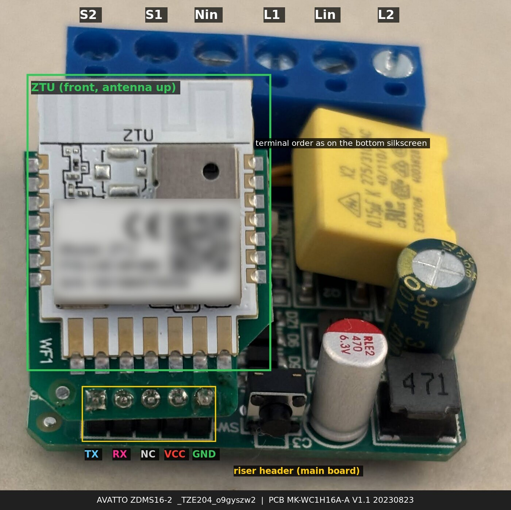
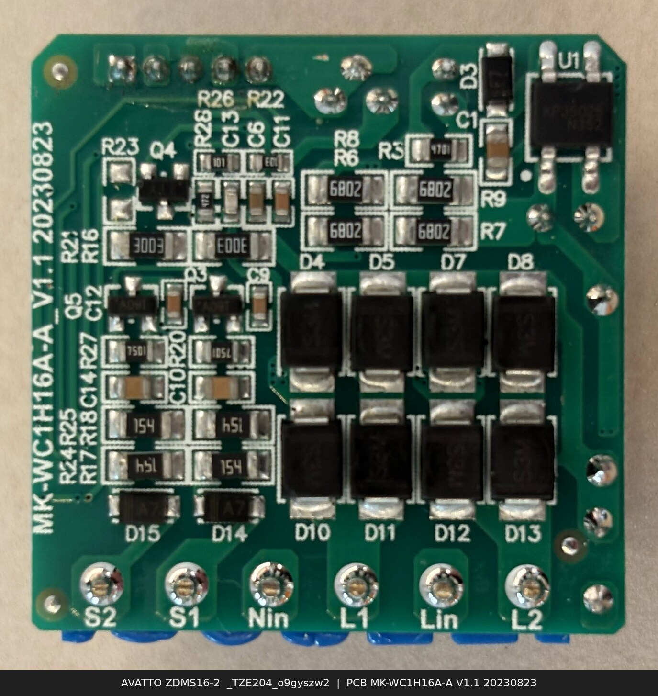
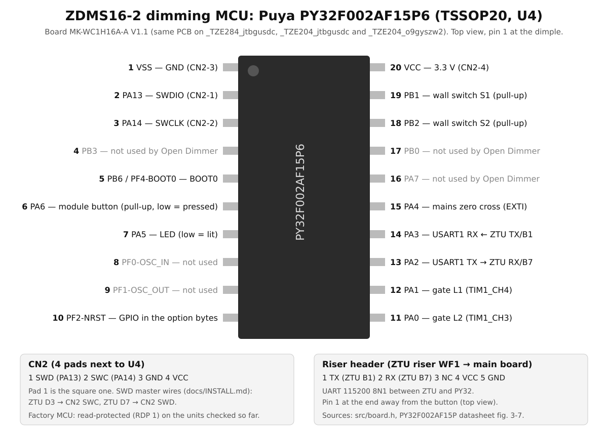

# `_TZE204_o9gyszw2`: a third ZDMS16-2 variant

An AVATTO ZDMS16-2 module that reports itself as `_TZE204_o9gyszw2` (model `TS0601`). It has the
same board, Zigbee module and dimming MCU as the tested `_TZE284_jtbgusdc` module. Open Dimmer
has not been installed on it yet: this page records what the module is before anything is
written to it.

## Identity (Zigbee2MQTT, factory firmware)

| | |
|---|---|
| Model / manufacturer | `TS0601` / `_TZE204_o9gyszw2` |
| Manufacturer code | 4417 |
| Firmware | Zigbee module **1.0.10** (`appVersion` 74), MCU **1.0.13** (`swBuildId` "Zigbee module: 1.0.10, MCU module: 1.0.13") |
| hwVersion / ZCL | 1 / 3 |
| Endpoints | 1: Groups, Scenes, Tuya `0xEF00`, Basic; 242: Green Power |
| Converter | zigbee-herdsman-converters matches it to AVATTO ZDMS16-2, the same definition as `_TZE284_jtbgusdc` |

- The stock MCU firmware is newer than on the tested `_TZE284_jtbgusdc` unit (1.0.13 vs 1.0.7).
- The ZDMS16-2 definition has no OTA, so Zigbee2MQTT refuses an update check ("does not support
  OTA updates") and the factory image type and file version were not read. They are probably
  4417 / 54179 (as on every Tuya Telink ZTU image) and file version 74: **not measured**.

## Hardware

Same board as the tested module: **MK-WC1H16A-A V1.1 20230823**.

- **Zigbee module:** Tuya ZTU (Telink TLSR8258) on the riser WF1, which plugs into a 5-pin
  header on the main board.
- **Dimming MCU (U4):** Puya **PY32F002A**, marking `PY32F002A / F15P6` and a lot code, TSSOP20.
- **CN2:** four SWD pads next to U4.
- Two factory jumper wires on the top side; on the bottom 8 × S3M (two bridges), the buck U1,
  Q3–Q5 and the terminals S2, S1, Nin, L1, Lin, L2.

| Top | Bottom |
|---|---|
|  |  |

| U4 and CN2 | U4 marking |
|---|---|
|  |  |

### Pinout

The pin functions come from Open Dimmer's [`src/board.h`](../src/board.h) (read from the factory
firmware of the WiFi twin board, see [stock-firmware-analysis.md](stock-firmware-analysis.md)) and
the PY32F002AF15P datasheet. The board is the same on all three variants.

| CN2 pad | Signal | Riser header pin | Signal |
|---|---|---|---|
| 1 (square) | SWD (PA13) | 1 | TX (ZTU B1 → PY32 PA3) |
| 2 | SWC (PA14) | 2 | RX (ZTU B7 ← PY32 PA2) |
| 3 | GND | 3 | NC |
| 4 | VCC | 4 | VCC |
| | | 5 | GND |

Riser header pin 1 is the end away from the button (top view). The ZTU pads are the same as in
[INSTALL.md](INSTALL.md) ([front view](img/ztu-d3-d7-swc-swd.png)).

## Backing up the factory Zigbee firmware

Keep a copy of the ZTU's factory firmware before converting a module. The Telink single-wire
(SWS) interface reads the whole 1 MB flash, including the Tuya configuration area at `0xF8000`
(on the UART-only ZDMS16-2 it holds no pin configuration). Only the SWS pad needs a soldered wire;
power comes from the riser header.

| USB-UART adapter | Module |
|---|---|
| RXD | SWS pad on the ZTU (4th pad from the antenna end, on the D3/D7 edge), directly |
| TXD | the same SWS pad, through a 1 kΩ resistor |
| 3.3 V | riser header pin 4 (VCC) |
| GND | riser header pin 5 (GND) |
| RTS (optional) | RST pad on the ZTU (not on the riser) |

1. **Mains off**, all mains wires disconnected.
2. 3.3 V on the riser VCC also powers the main board (the PY32 starts as well). Use an adapter
   whose 3.3 V output can supply the module, or a separate 3.3 V supply.
3. Read the flash with pvvx's [USBCOMFlashTx](https://pvvx.github.io/ATC_MiThermometer/USBCOMFlashTx.html)
   (1500000 baud, read `0x100000` bytes) or
   [Telink-Zigbee-serial-flash-tool](https://github.com/Suxsem/Telink-Zigbee-serial-flash-tool).
4. Keep the file; it also holds the module's network keys, so do not publish it.

## The dimming MCU

The factory PY32 firmware on the tested `_TZE284_jtbgusdc` unit was read-protected (RDP 1): its
flash cannot be read over SWD, and lifting the protection erases it. The same is expected here.
The read-only `survey_full` job of the fork's SWD master (wires D3 → CN2 SWC, D7 → CN2 SWD) or an
SWD probe on CN2 reads the option bytes and shows the protection level without changing anything.

## Status

- Not converted yet. The fork's device database knows the `jtbgusdc` names only; converting this
  variant needs an entry for `_TZE204_o9gyszw2`.
- Results from other units are welcome: open an issue with the module's `swBuildId` and the board
  marking.
