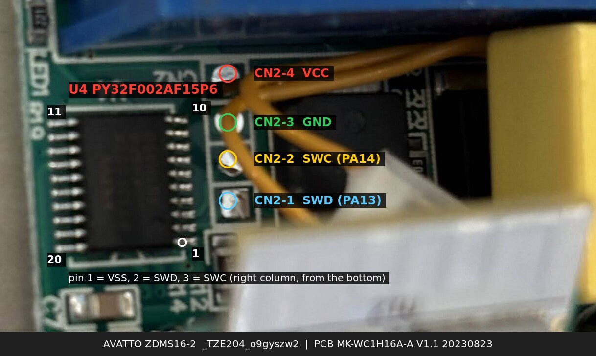
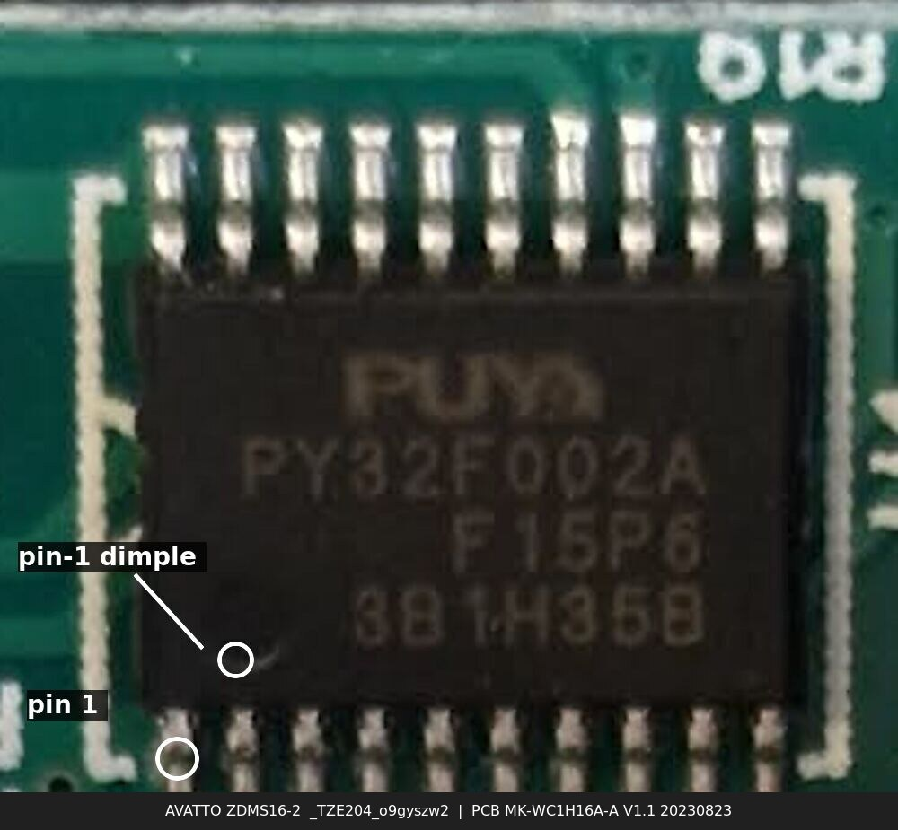
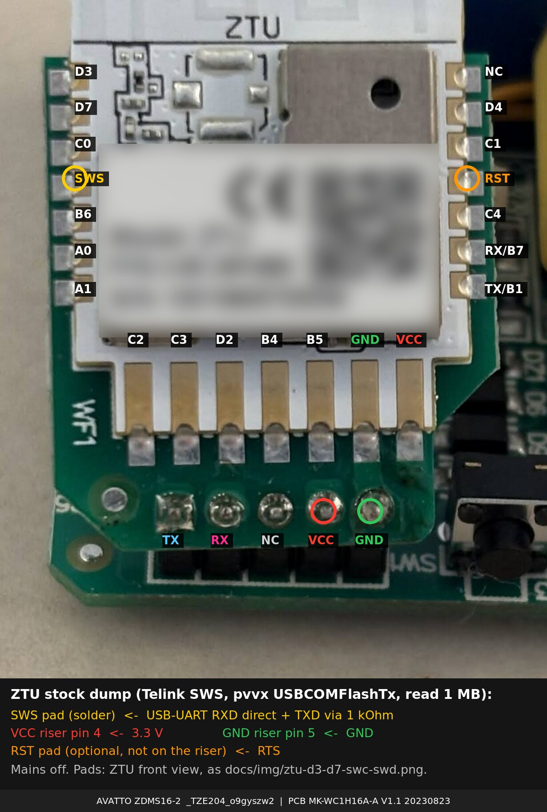

# `_TZE204_o9gyszw2`: a third ZDMS16-2 variant

An AVATTO ZDMS16-2 module that reports itself as `_TZE204_o9gyszw2` (model `TS0601`). It has the
same board, Zigbee module and dimming MCU as the tested `_TZE284_jtbgusdc` module, but its
factory dimming MCU is **not read-protected**. This page records the factory state and what it
took to convert the tested unit.

## Identity (Zigbee2MQTT, factory firmware)

| | |
|---|---|
| Model / manufacturer | `TS0601` / `_TZE204_o9gyszw2` |
| Manufacturer code | 4417 |
| Firmware | Zigbee module **1.0.10** (`appVersion` 74), MCU **1.0.13** (read from the MCU by the converted module; the stock `swBuildId` showed "MCU module: 1.0.13" and later "MCU module: 1.0.3") |
| hwVersion / ZCL | 1 / 3 |
| Endpoints | 1: Groups, Scenes, Tuya `0xEF00`, Basic; 242: Green Power |
| Converter | zigbee-herdsman-converters matches it to AVATTO ZDMS16-2, the same definition as `_TZE284_jtbgusdc` |

- The stock MCU firmware is newer than on the tested `_TZE284_jtbgusdc` unit (1.0.13 vs 1.0.7).
- The ZDMS16-2 definition has no OTA, so Zigbee2MQTT refuses an update check ("does not support
  OTA updates"). With a converter that adds OTA for this name, Zigbee2MQTT offers the conversion
  image (manufacturer 4417, image type 54179, the same as the `jtbgusdc` units): the factory
  image type is 54179.

## Hardware

Same board as the tested module: **MK-WC1H16A-A V1.1 20230823**.

- **Zigbee module:** Tuya ZTU (Telink TLSR8258) on the riser WF1, which plugs into a 5-pin
  header on the main board.
- **Dimming MCU (U4):** Puya **PY32F002A**, marking `PY32F002A / F15P6` and a lot code, TSSOP20.
- **CN2:** four SWD pads next to U4.
- Two factory jumper wires on the top side; on the bottom 8 × S3M (two bridges), the buck U1,
  Q3–Q5 and the terminals S2, S1, Nin, L1, Lin, L2.

| Top | Bottom |
|---|---|
|  |  |

| U4 and CN2 | U4 marking |
|---|---|
|  |  |

### Pinout

The pin functions come from Open Dimmer's [`src/board.h`](../src/board.h) (read from the factory
firmware of the WiFi twin board, see [stock-firmware-analysis.md](stock-firmware-analysis.md)) and
the PY32F002AF15P datasheet. The board is the same on all three variants.

| CN2 pad | Signal | Riser header pin | Signal |
|---|---|---|---|
| 1 (square) | SWD (PA13) | 1 | TX (ZTU B1 → PY32 PA3) |
| 2 | SWC (PA14) | 2 | RX (ZTU B7 ← PY32 PA2) |
| 3 | GND | 3 | NC |
| 4 | VCC | 4 | VCC |
| | | 5 | GND |

Riser header pin 1 is the end away from the button (top view). The ZTU pads are the same as in
[INSTALL.md](INSTALL.md) ([front view](img/ztu-d3-d7-swc-swd.png)).

## Backing up the factory Zigbee firmware

Keep a copy of the ZTU's factory firmware before converting a module. The Telink single-wire
(SWS) interface reads the whole 1 MB flash, including the Tuya configuration area at `0xF8000`
(on the UART-only ZDMS16-2 it holds no pin configuration). Only the SWS pad needs a soldered wire;
power comes from the riser header.

| USB-UART adapter | Module |
|---|---|
| RXD | SWS pad on the ZTU (4th pad from the antenna end, on the D3/D7 edge), directly |
| TXD | the same SWS pad, through a 1 kΩ resistor |
| 3.3 V | riser header pin 4 (VCC) |
| GND | riser header pin 5 (GND) |
| RTS (optional) | RST pad on the ZTU (not on the riser) |

1. **Mains off**, all mains wires disconnected.
2. 3.3 V on the riser VCC also powers the main board (the PY32 starts as well). Use an adapter
   whose 3.3 V output can supply the module, or a separate 3.3 V supply.
3. Read the flash with pvvx's [USBCOMFlashTx](https://pvvx.github.io/ATC_MiThermometer/USBCOMFlashTx.html)
   (1500000 baud, read `0x100000` bytes) or `TLSR825xComFlasher.py` from
   [TlsrComSwireWriter](https://github.com/pvvx/TlsrComSwireWriter) (`rf 0 0x100000 dump.bin`).
   [Telink-Zigbee-serial-flash-tool](https://github.com/Suxsem/Telink-Zigbee-serial-flash-tool)
   reads back over the ZTU's own UART (B1/B7), which the PY32 also drives on this board.
4. Keep the file; it also holds the module's network keys, so do not publish it.

> [!WARNING]
> **Not done: the dump of the tested unit failed.** The adapter's own echo (TXD → 1 kΩ → RXD)
> stopped as soon as the wire touched the SWS pad, also with the RST pad held low, so no tool
> could reach the chip (`Chip sleep?`). The neighbouring B6 pad stopped the echo as well; D3, D7,
> C0, A0 and A1 did not. A solder bridge between SWS and B6 or a load on the SWS line is
> suspected, not confirmed. Tried: a CP2102 adapter (its 3.3 V output tripped the USB
> over-current protection when connected to the module) and a Raspberry Pi Debugprobe (RP2040) as
> the USB-UART (its UART forwards only with DTR set). The tested unit has no backup: no factory
> ZTU image of this variant exists yet.

## The dimming MCU

Unlike the `jtbgusdc` units (read-protected, RDP 1, user option byte 0xF0), the factory PY32 of
this variant is at **RDP 0**: `FLASH_OPTR` 0x0000BEAA. Its user option byte 0xBE leaves the brown-out
reset off and NRST a reset pin (on the `jtbgusdc` units NRST is a GPIO; Open Dimmer writes 0xF9:
brown-out reset on, NRST a GPIO; no NRST wire is used, so the change does nothing on this board).

- **The factory firmware can be read** over SWD (CN2) before anything is written; the install
  erases it. It takes the SWD pins about 1.5 s after power-up, so a probe or the fork's SWD master
  attaches right after power-up (about 220 ms on the tested unit).
- Same Tuya MCU SDK base as the factory firmware of the WiFi twin board (DMS16-W1 1.0.3), as a real
  2-channel build. It has **no MCU OTA commands** (0x0C–0x0E): the factory dimming firmware cannot
  be updated over Zigbee.
- The system ROM's CRC differs from the `jtbgusdc` chips' (0x62889B8E vs 0xA52232EA) with the same
  debug port, CPUID and IDCODE; installing and writing the bootloader worked on it.
- The read-only `survey_full` job of the fork's SWD master (wires D3 → CN2 SWC, D7 → CN2 SWD) or an
  SWD probe on CN2 reads the option bytes and shows the protection level without changing anything.

**Install:** the fork's builds from the 2.2.8 release (2026-11-24) on install Open Dimmer on this
MCU too: an RDP 0 factory MCU gets its pages erased by the install (instead of the mass erase
that lifting RDP 1 does), then Open Dimmer's option bytes and the bootloader. On the tested unit
it took 15.5 s, then the bootloader fetched the app over the UART. Earlier builds took
read-protected (RDP 1) factory MCUs only and refused this one (`wrong class`).

## Status

- Zigbee firmware converted on the tested unit: the fork's `-from_tuya` image (the same one as for
  `jtbgusdc`). From the 2.2.8 release on the fork's converter and OTA index list
  `_TZE204_o9gyszw2` too, so Zigbee2MQTT offers the conversion with the fork's converter alone
  (the tested unit was converted through a temporary converter, before that).
- Open Dimmer on the dimming MCU: installed on the tested unit with a development build of the
  RDP 0 path above, released with 2.2.8.
- After the conversion the module came back to the network only with Permit join open (also seen
  on a `jtbgusdc` unit converted the same day). Fixed in the fork from the 2.2.8 release on: a
  converted module keeps its network (verified on a `jtbgusdc` unit).
- The factory ZTU firmware was not backed up (the SWS dump failed, see above).
- Results from other units are welcome: open an issue with the module's `swBuildId` and the board
  marking.
